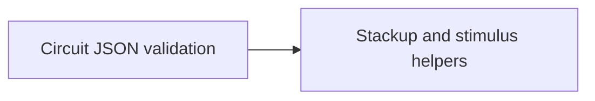
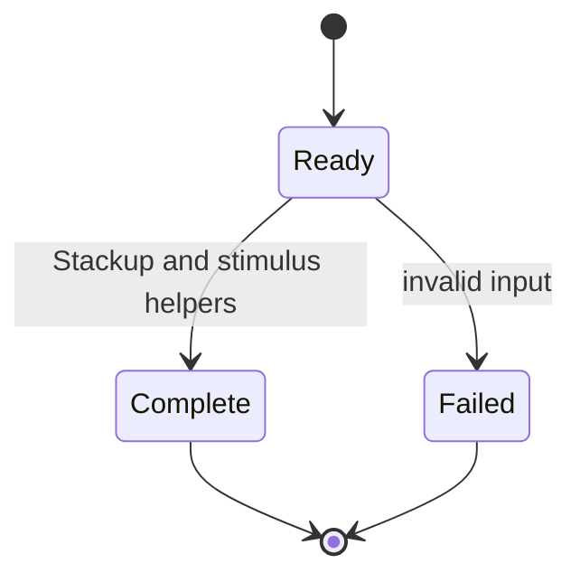

# Signal-integrity pipeline architecture

The stack retains Circuit JSON validation, physical stackup and stimulus helpers, IBIS asset loading and the ngspice adapter.

## Local vendor IBIS models

For each entry in `examples/vendor-models.lock.json`, download the ZIP from
`url` and verify its SHA-256 against `archiveSha256`. Extract the member at
`archivePath` as `file` and verify it against `sha256`. Put the extracted
files in the directory named by `IBIS_MODEL_DIR` to enable the vendor channel tests.

The manufacturers retain copyright. Keep the files local and follow the vendors' redistribution terms.
