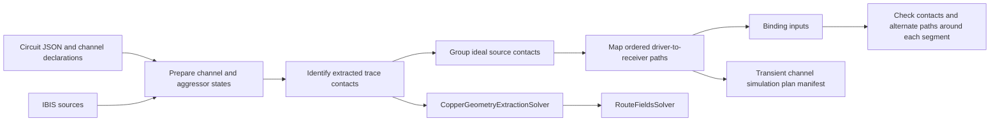
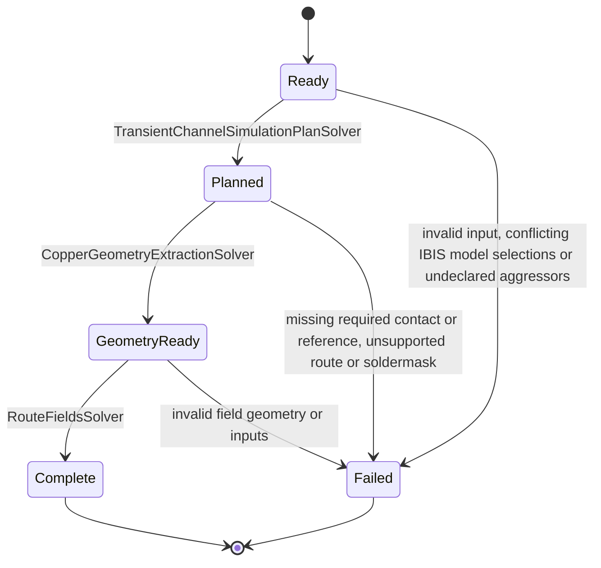
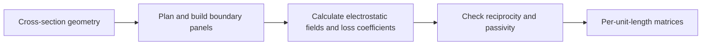
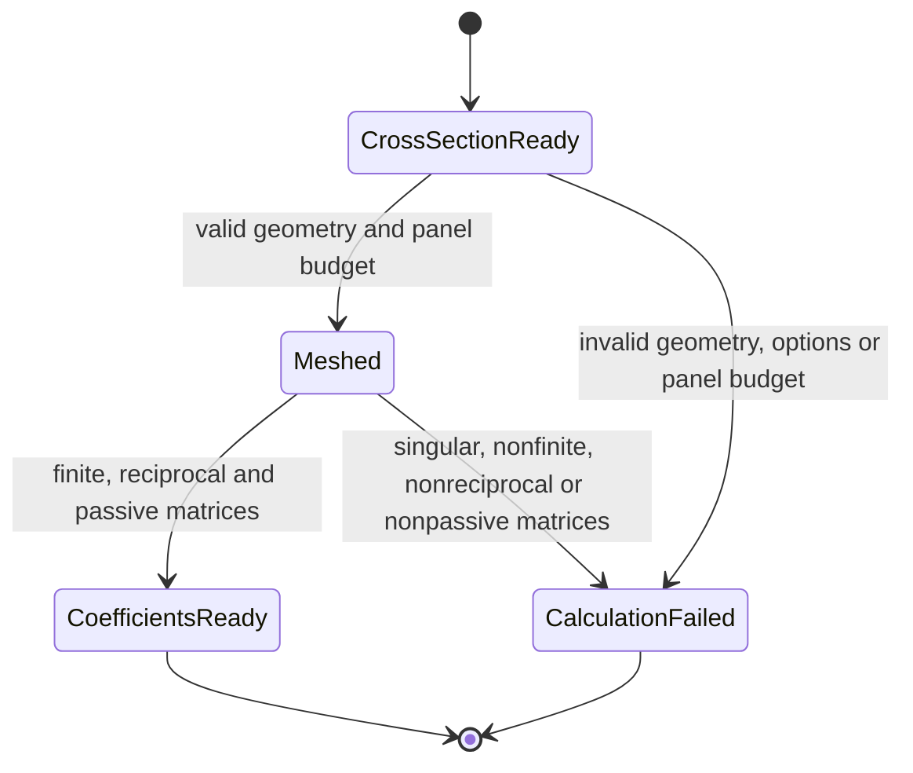

# Signal-integrity pipeline architecture

The stack retains Circuit JSON validation, physical stackup and stimulus helpers, IBIS asset loading and the ngspice adapter.
Declare transient channels in Circuit JSON. Signal preparation validates endpoint topology, selected IBIS capabilities,
timing, pseudo-random binary sequence (PRBS) patterns and declared aggressor states.
TransientChannelSimulationPlanSolver lowers each declared channel simulation into immutable inputs for copper geometry extraction and buffer binding.
Ideal wires, named nets and internal pin ties form the source groups used by SPICE.
A named net can span the extracted traces connecting its own contacts, including multipoint ideal junctions.
Channel planning and binding use the same receiver graph. Its paths traverse ideal junctions, extracted traces and series passives.
Rail shunts and differential terminations stay outside those paths, including terminations attached by both copper and ideal wires.
Each extracted trace keeps both physical contacts. Binding checks their selected models and detects signal contacts tied to ground.
Removing an extracted trace or series passive from the receiver graph must disconnect its two ends.
An alternate path reports the physical contacts and distinguishes an entirely routed loop from a bypass through ideal wiring.
`CopperGeometryExtractionSolver` models scoped traces, vias, reference pours, and pad contacts. It groups wires into sections with consistent nearby copper and reference surfaces.

RouteFieldsSolver maps each routed section to its electrical coefficients and screens nearby pairs for coupling.

## 2D RLGC calculation

The internal `calculateRlgc` function in `src/rlgc/` calculates the per-unit-length matrices in input conductor order.
Capacitance (with dielectrics and in vacuum) is in F/m, external inductance is in H/m and DC resistance is in Ω/m.
For frequency `f` in Hz, multiply the dielectric loss coefficient (F/m) by `2πf` for conductance in S/m.
Multiply the skin resistance coefficient (Ω/m/√Hz) by `√f` for the high-frequency skin contribution in Ω/m.
The calculation also returns the conductor-only skin coefficient, obtained with fixed reference planes.

Interfaces in a half-space extend by the requested number of cross-section spans. Between two reference planes, padding is measured in the lateral field decay length (plane spacing divided by π). Each shielded region is limited to 3072 boundary panels before dense matrix allocation.

The native adapter waits for the executable to exit. The legacy caller-specified timeout and its dedicated diagnostic were removed. IBIS source validation continues to check paths and reject non-IBIS data. The previous byte-size limit was removed.
