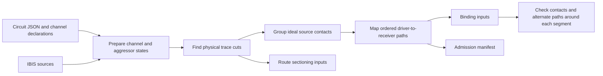
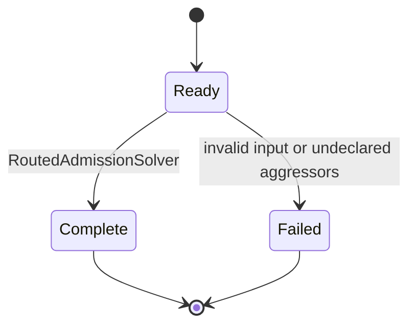

# Signal-integrity pipeline architecture

The stack retains Circuit JSON validation, physical stackup and stimulus helpers, IBIS asset loading and the ngspice adapter.
Declare transient channels in Circuit JSON. Signal preparation validates endpoint topology, selected IBIS capabilities,
timing, pseudo-random binary sequence (PRBS) patterns and declared aggressor states.
RoutedAdmissionSolver lowers each declared channel simulation into immutable inputs for route sections and buffer binding.
Ideal wires, named nets and internal pin ties form the source groups used by SPICE.
A named net can span the cuts connecting its own contacts, including multipoint ideal junctions.
Admission and binding use the same receiver graph. Its paths traverse ideal junctions, physical cuts and series passives.
Rail shunts and differential terminations stay outside those paths, including terminations attached by both copper and ideal wires.
Each cut keeps both physical contacts. Binding checks their selected models and detects signal contacts tied to ground.
Removing a cut or series passive from the receiver graph must disconnect its two ends.
An alternate path reports the physical contacts and distinguishes an entirely routed loop from a bypass through ideal wiring.

