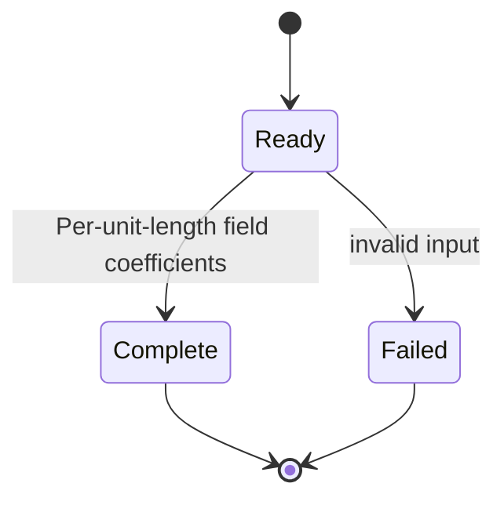

# Signal-integrity pipeline architecture

The stack retains Circuit JSON validation, physical stackup and stimulus helpers, IBIS asset loading and the ngspice adapter.
Declare transient channels in Circuit JSON. Signal preparation validates endpoint topology, selected IBIS capabilities,
timing, pseudo-random binary sequence (PRBS) patterns and declared aggressor states.
RoutedAdmissionSolver lowers each declared channel simulation into immutable inputs for route sections and buffer binding.
Ideal wires, named nets and internal pin ties form the source groups used by SPICE.
Receiver paths traverse those groups through physical trace cuts and series components.
Each cut keeps both physical contacts for sectioning even when one contact shares an ideal node with another cut.
RouteSectionsSolver divides scoped copper into straight slices and resolves physical endpoint contacts.
The standalone 2D cross-section solve returns per-unit-length C/C0/L and frequency-dependent R/G.

