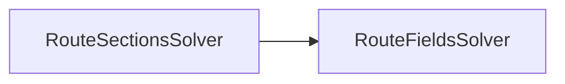
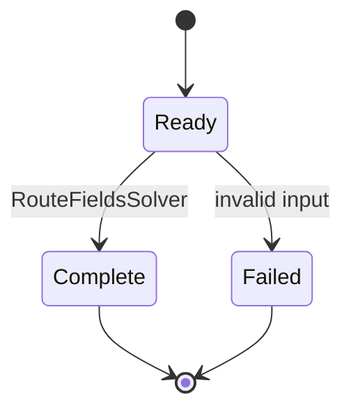

# Signal-integrity pipeline architecture

The stack retains Circuit JSON validation, physical stackup and stimulus helpers, IBIS asset loading and the ngspice adapter.
Declare transient channels in Circuit JSON. Signal preparation validates endpoint topology, selected IBIS capabilities,
timing, pseudo-random binary sequence (PRBS) patterns and declared aggressor states.
RoutedAdmissionSolver lowers each declared channel simulation into immutable inputs for route sections and buffer binding.
Ideal wires, named nets and internal pin ties form the source groups used by SPICE.
A named net can span the cuts connecting its own contacts without absorbing an unlabeled branch.
Admission and binding use the same receiver graph. Its paths traverse ideal junctions, physical cuts and series passives. Rail shunts and differential terminations stay outside those paths.
Each cut keeps both physical contacts. Binding checks their selected models, detects signal contacts tied to ground, and distinguishes routed loops from ideal bypasses.
RouteSectionsSolver divides scoped copper into straight slices and resolves physical endpoint contacts.
The standalone 2D cross-section solve returns per-unit-length C/C0/L and frequency-dependent R/G.
RouteFieldsSolver screens nearby conductor pairs and extracts coupled coefficients for each unique section.

