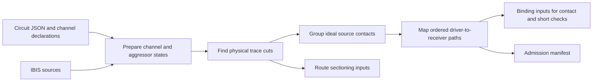
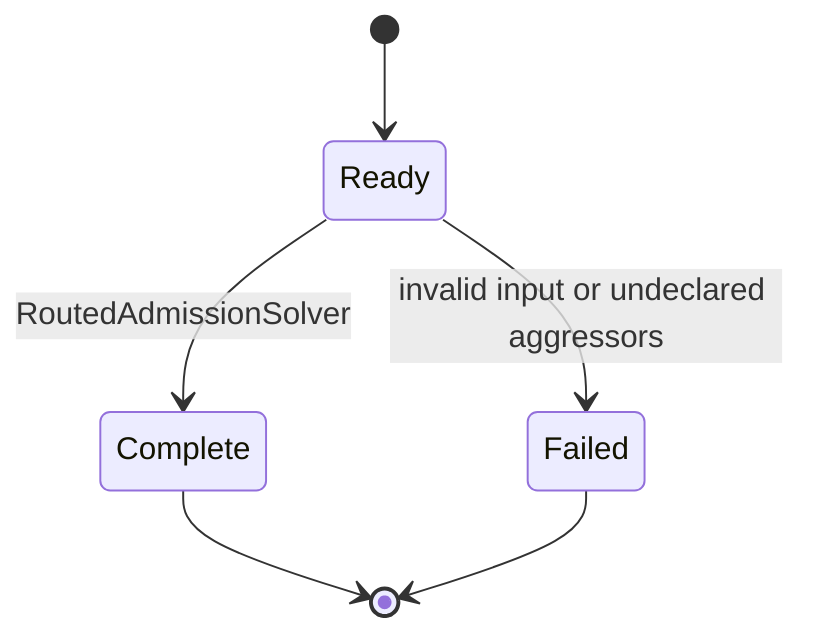

# Signal-integrity pipeline architecture

The stack retains Circuit JSON validation, physical stackup and stimulus helpers, IBIS asset loading and the ngspice adapter.
Declare transient channels in Circuit JSON. Signal preparation validates endpoint topology, selected IBIS capabilities,
timing, pseudo-random binary sequence (PRBS) patterns and declared aggressor states.
RoutedAdmissionSolver lowers each declared channel simulation into immutable inputs for route sections and buffer binding.
Ideal wires, named nets and internal pin ties form the source groups used by SPICE.
A named net can span the cuts connecting its own contacts without absorbing an unlabeled branch.
Receiver paths traverse ideal contacts, physical cuts and series components.
Binding checks the full differential paths, including ideal junctions between passives.
Each cut keeps both physical contacts for sectioning even when one contact shares an ideal node with another cut.

